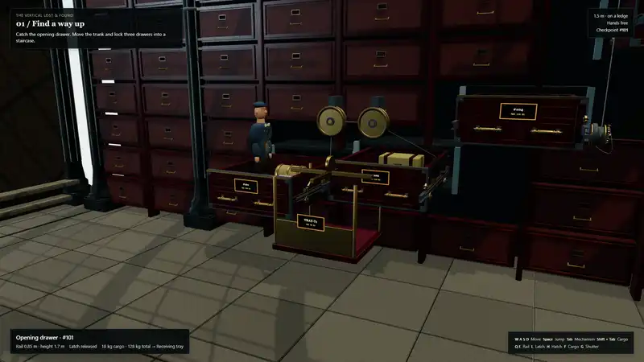

# The Vertical Lost & Found

[English](README.md) · [简体中文](README.zh-CN.md) · [日本語](README.ja.md) · [한국어](README.ko.md)

<p align="center">
  <a href="https://github.com/Emily2040/vertical-lost-and-found/raw/HEAD/showcase-1080p60.mp4">
    
  </a>
</p>

https://github.com/user-attachments/assets/b126354c-ce20-4bfc-b07f-9eb815dfc5b7

<p align="center">
  <a href="https://github.com/Emily2040/vertical-lost-and-found/raw/HEAD/showcase-1080p60.mp4"><strong>下载带立体声音频的原始 1080p60 视频（MP4，57 MB）</strong></a>
</p>

## 提示词

```text
在一座废弃铁路大厅内，沿着一面巨型抽屉墙构建一款攀爬解谜游戏。

开场时，我脚下的抽屉猛地弹开。里面的物品滚进接料托盘，牵动配重，正好在我起跳的瞬间拉开下一个抽屉。

让我一边改变机关的负重，一边向上攀爬。沿导轨拉动抽屉，在可见的卡槽处锁紧，并在相连的托盘之间转移沉重的物品。同一个抽屉既可以当台阶、升降台，也可以充当配重，完全取决于我如何使用它。

在抽屉墙里摆满一眼可辨的旧物：大衣箱、卷起的地毯、装盒的乐器和陶瓷包裹。在 Blender 中为导轨、滚轮、外露钢索和传送滑槽建模。使用 Nano Banana 生成盘出包浆的漆面、行李帆布和磨旧内衬的纹理。

第一关用三个抽屉搭出一段阶梯。第二关在相连的抽屉之间转移一只重箱，在保留退路的同时升起升降台。第三关则需要通过一连串向上的负重转移、移动平台和卡准时机的跳跃完成攀登。

保持每件物品的身份与质量不变。我的体重必须对未锁定的平台产生实际影响，插销也必须咬合真实的卡槽。

最后从内部推开最顶上的抽屉。阳光照进来，巨大的储物墙外露出一座屋顶花园。将完整的通关过程录制成一段紧凑有力的一分钟演示视频。
```

完整制作任务说明：[English](prompts/en.md) · [简体中文](prompts/zh-CN.md) · [日本語](prompts/ja.md) · [한국어](prompts/ko.md) · [提示词指南](prompts/README.md)。

## 项目简介

使用 **Google Antigravity 中的 Gemini 4** 制作，结合 Nano Banana 生成的纹理图像、Blender 和 Three.js。

这是一款以铁路档案馆为场景的攀爬解谜游戏。沿导轨拉出抽屉并锁定位置，再搬运行李来驱动升降机构。三个关卡从最初的抽屉一路通向屋顶花园。

当前公开的是供审阅的开发版本。保存的操作路线已验证机关能够运作，但角色、重复排列的柜体和灯光仍未达到照片级真实感的目标。完整的动态画面审看、音频试听和声画同步检查尚未进行。本项目经过多轮迭代；提示词无法保证生成完全相同的资产或结果。要运行本仓库的具体实现，请使用下方说明中的已提交源码和资产。

## 本地运行

需要 Node.js 20 或更新版本。游玩无需 API 密钥。

```sh
npm ci
npm run dev
```

在浏览器中打开 Vite 输出的本地地址。构建并预览生产版本：

```sh
npm run build
npm run preview
```

## 操作

| 按键 | 功能 |
|---|---|
| W A S D | 移动 |
| Space | 跳跃 |
| Tab / Shift + Tab | 选择够得到的机关 / 货物 |
| Q / E | 推入 / 拉出所选导轨 |
| L | 在导轨卡位处锁止或解锁 |
| H | 打开或关闭货舱门 |
| F | 拿起、放下或送出货物 |
| G | 从内部打开最后一个抽屉 |
| R | 返回最近的检查点 |

游戏内的提示会说明当前选中的目标。进行交互后声音才会启用，也可以静音。

## 验证与编辑

```sh
npm run verify
```

此命令会构建应用，执行 82 项机关与物理机制检查，并以常规操作跑通四条路线。生成的测试证据保存在 `.run/verification/`。这些检查不包含真实玩家的难度测试，后者需要另行进行。

可编辑的 `.blend` 文件位于 `assets/blender/`。仓库还包含几何构建脚本、生成的原始纹理、材质处理脚本和持久化场景记录。详见[制作说明](docs/authoring.md)、[录制说明](docs/recording.md)和[验证说明](docs/verification.md)。

一分钟的演示视频包含 3,600 个模拟采样画面，分辨率为 1920 × 1080，配有立体声音频。视频通过实际的游戏控制接口离线采集。另一项独立回放基准测试在测试机器上测得每秒渲染 37.33 次；这个数值不代表完整实时游玩的帧率。

本项目采用受约束的角色与支撑面控制器，以及基于解析式计算的机关模型；货物的拾取和放置通过离散操作完成。它不是通用刚体模拟器。

[材质来源](docs/provenance.md) · [第三方声明](THIRD_PARTY_NOTICES.md)
